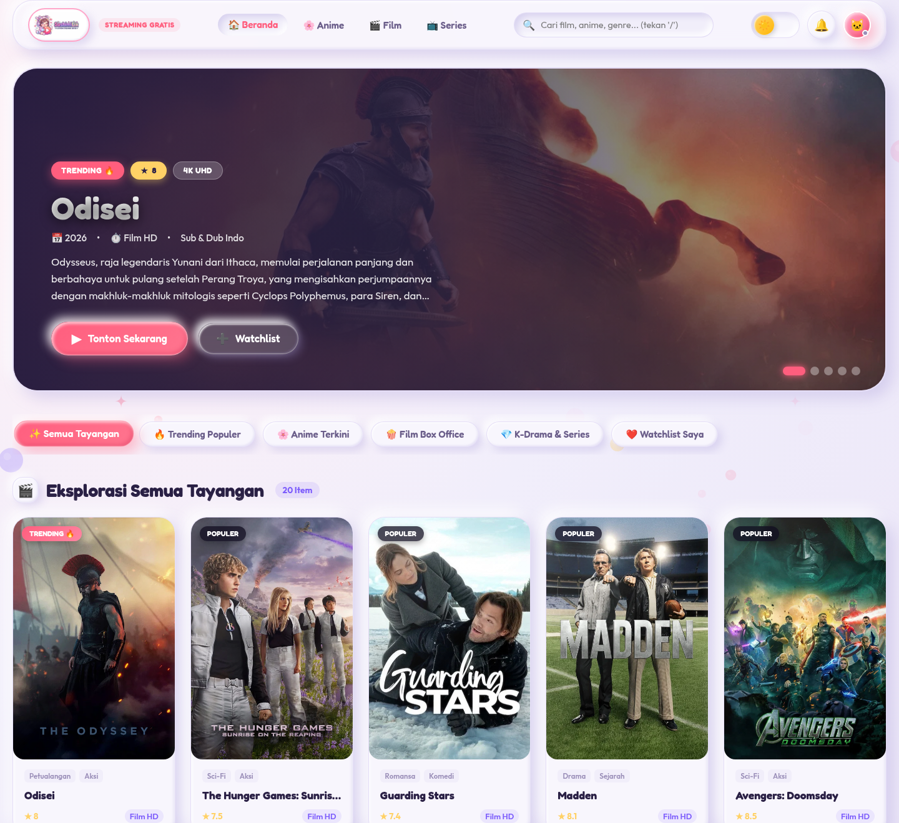
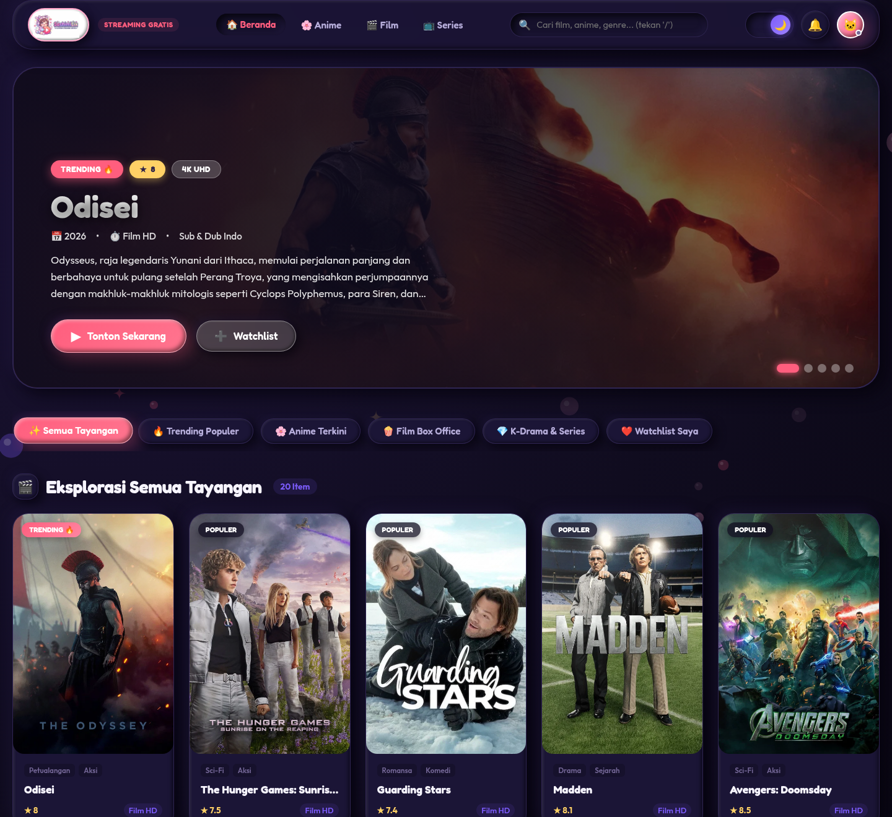
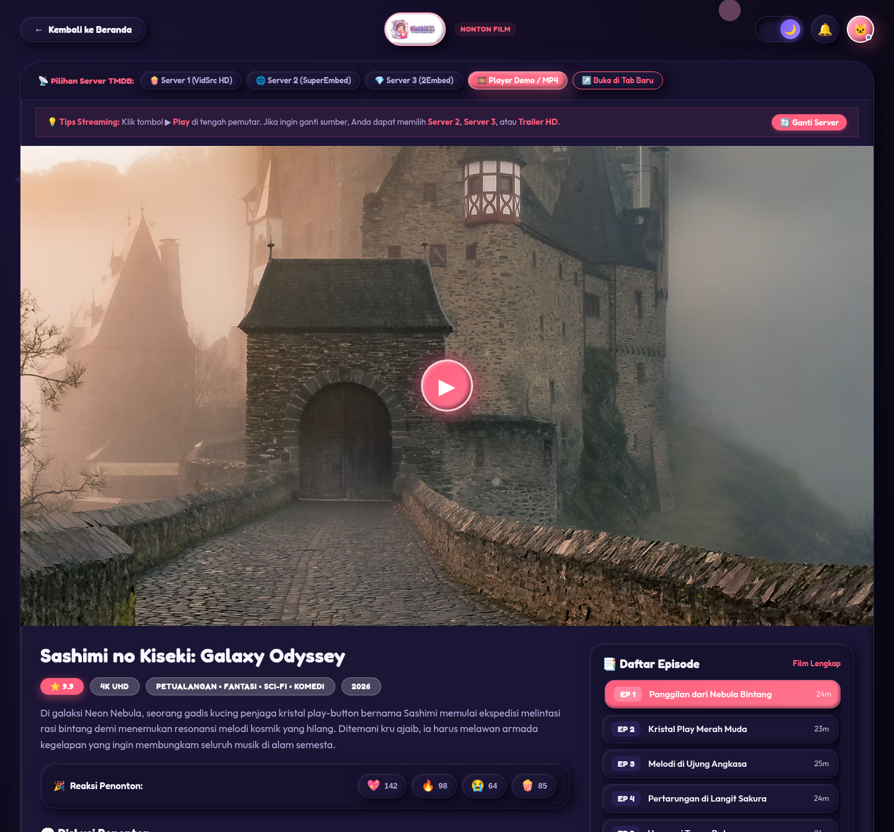
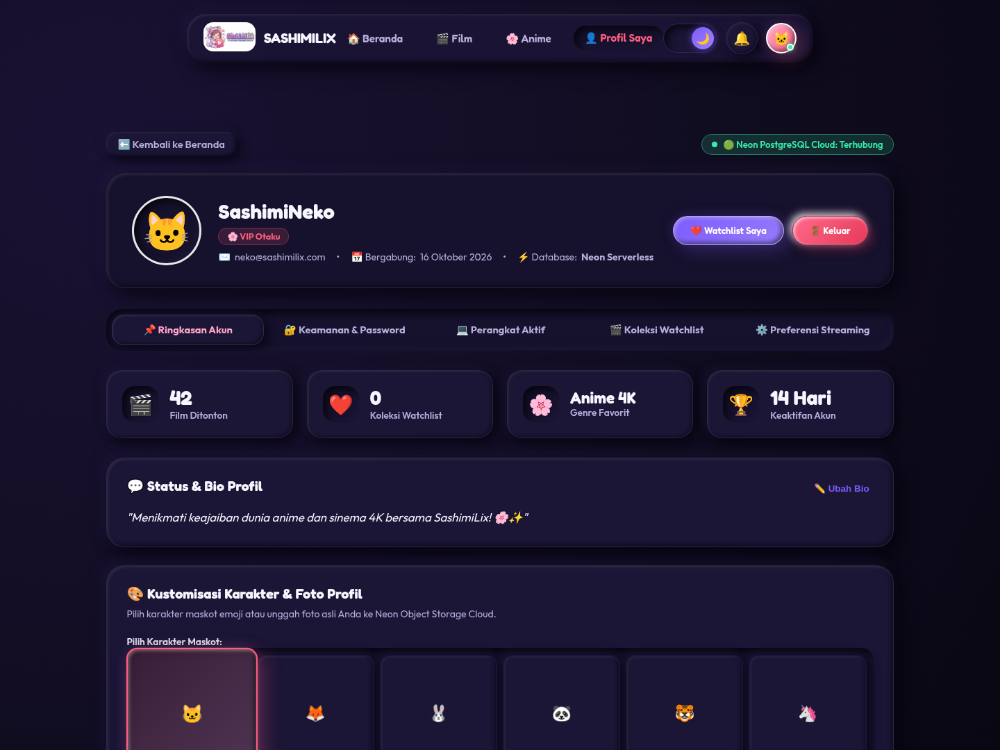

<h3>Platform Streaming Anime, Film Box Office &amp; Serial Drama dengan Estetika 3D Claymorphism</h3>

  
  
  
  
  

  <a href="#tentang-sashimilix">Tentang</a> &bull;
  <a href="#showcase-antarmuka">Showcase</a> &bull;
  <a href="#fitur-unggulan">Fitur Unggulan</a> &bull;
  <a href="#sistem-desain">Sistem Desain</a> &bull;
  <a href="#teknologi-yang-digunakan">Teknologi</a>

---

## Tentang SashimiLix

**SashimiLix** adalah platform web streaming modern yang menghadirkan koleksi **anime**, **film box office**, dan **serial drama** dalam satu antarmuka yang imersif, halus, dan interaktif. Dirancang dengan bahasa visual **3D Claymorphism** yang terinspirasi langsung dari palet warna maskot SashimiLix, setiap komponen—mulai dari kartu katalog, tombol interaktif, hingga bilah navigasi kaca—menghadirkan kedalaman lembut, animasi kenyal (*squish physics*), serta umpan balik audio interaktif.

Platform ini memadukan katalog tayangan dinamis berbasis **TMDB API**, halaman pemutar sinematik layar penuh dengan dukungan **multi-server**, serta ekosistem akun pengguna berbasis cloud menggunakan **Neon Serverless PostgreSQL**, **Google OAuth 2.0**, dan **Neon Object Storage**.

---

## Showcase Antarmuka

### 1. Beranda — Dual Theme (*Marshmallow Pastel* &amp; *Cosmic Midnight*)

Tampilan beranda menyajikan **Hero Featured Carousel**, pencarian instan (*live search*), tab filter kategori interaktif, serta grid kartu 3D Clay dengan informasi genre, rating, dan kualitas tayangan. Pengguna dapat berpindah antara mode terang dan mode gelap secara instan.

| Mode Terang (*Marshmallow Pastel*) | Mode Gelap (*Cosmic Midnight*) |
| :---: | :---: |
|  |  |
| *Nuansa pastel lembut dengan bayangan clay halus yang cerah dan nyaman untuk eksplorasi siang hari.* | *Nuansa kosmik gelap elegan dengan aksen neon coral dan lilac untuk kenyamanan menonton malam hari.* |

---

### 2. Layar Teater Sinematik (*Watch Page*)

Halaman tonton dirancang khusus dalam mode layar penuh tanpa pop-up yang mengganggu. Dilengkapi bilah pemilihan multi-server beserta tombol *quick failover*, daftar episode interaktif di sisi kanan, reaksi emoji *real-time*, kolom diskusi penonton, serta rekomendasi tayangan terkait.

  
   
  <em>Antarmuka pemutar sinematik dengan pemilihan multi-server, daftar episode terstruktur, metadata 4K UHD, dan bar reaksi penonton.</em>

---

### 3. Dashboard Profil VIP (*Profile Page*)

Pusat pengelolaan akun pengguna yang terhubung langsung dengan **Neon PostgreSQL Cloud**. Pengguna dapat memantau statistik tontonan, mengubah bio, mengustomisasi karakter maskot atau mengunggah foto profil pribadi, mengelola keamanan kata sandi, memantau perangkat aktif, mengatur koleksi *watchlist*, hingga menyimpan preferensi pemutar.

  
   
  <em>Dashboard profil pengguna VIP dengan indikator status cloud, kartu statistik 3D, editor bio, dan kustomisasi avatar.</em>

---

## Fitur Unggulan

### Pengalaman Visual &amp; Interaksi
- **Estetika 3D Claymorphism** — Kartu, tombol, kapsul navigasi, dan lencana (*badge*) dirancang dengan lapisan bayangan ganda (*outer* &amp; *inner shadows*) dan transisi elastis (*cubic-bezier squish*).
- **Mode Terang &amp; Gelap Instan** — Pergantian mulus antara tema *Marshmallow Pastel* dan *Cosmic Midnight* yang tersimpan otomatis pada preferensi pengguna.
- **Partikel Latar Ambien** — Kanvas animasi gelembung clay dan bintang melayang (*ambient floating canvas*) yang ringan dan menambah kesan hidup.
- **Efek Suara Pop Interaktif** — Sintesis audio langsung melalui *Web Audio API* (efek *pop*, *bubble*, dan *burst*) dengan tombol kontrol bisu/aktif di bilah navigasi.

### Eksplorasi &amp; Katalog Tayangan
- **Integrasi Katalog TMDB Real-Time** — Menyajikan tayangan *trending*, anime terkini, film box office, serta K-Drama dan serial populer lengkap dengan sinopsis bahasa Indonesia, rating, tahun rilis, dan poster beresolusi tinggi.
- **Hero Featured Carousel** — Sorotan tayangan unggulan di bagian atas beranda dengan informasi kualitas (*4K UHD*), rating, durasi, serta akses cepat ke pemutar dan *watchlist*.
- **Pencarian Langsung &amp; Filter Cepat** — Kolom pencarian instan dengan pintasan papan ketik (`/`) serta pil filter kategori (*Semua Tayangan*, *Trending Populer*, *Anime Terkini*, *Film Box Office*, *K-Drama &amp; Series*, dan *Watchlist Saya*).

### Pemutar Teater &amp; Komunitas
- **Pemilihan Multi-Server Fleksibel** — Mendukung beberapa sumber pemutar (VidSrc HD, SuperEmbed, 2Embed), **Trailer Resmi HD**, pemutar MP4 demo, fitur ganti server cepat (*failover*), serta opsi buka di tab baru.
- **Navigasi Episode Terstruktur** — Sidebar daftar episode lengkap dengan durasi dan indikator episode aktif untuk serial maupun anime.
- **Reaksi Emoji Real-Time &amp; Diskusi** — Penonton dapat mengirimkan semburan emoji mengambang langsung di layar video serta berinteraksi melalui kolom komentar komunitas.

### Akun VIP, Keamanan &amp; Cloud Sync
- **Autentikasi Lengkap &amp; Google OAuth 2.0** — Mendukung pendaftaran akun reguler, masuk cepat via Google OAuth, serta enkripsi kata sandi **SHA-256** dengan *cosmic salt*.
- **Sinkronisasi Watchlist Cloud** — Daftar tayangan favorit tersimpan secara persisten di **Neon Serverless PostgreSQL** sekaligus memiliki *fallback* lokal yang responsif.
- **Kustomisasi Avatar &amp; Object Storage** — Pilihan 12 karakter maskot emoji atau unggah foto pribadi yang disimpan aman di bucket **Neon Object Storage (S3-compatible)**.
- **Monitoring Sesi Perangkat Aktif** — Menampilkan daftar perangkat, peramban, sistem operasi, dan lokasi sesi aktif lengkap dengan kontrol untuk mengeluarkan semua perangkat lain.
- **Preferensi Streaming Personal** — Pengaturan resolusi default (*4K Ultra HD*, *1080p Full HD*, *720p HD*), server pemutar pilihan, dan bahasa takarir bawaan (*Indonesia*, *English*, *日本語*).

---

## Sistem Desain

Identitas visual SashimiLix diselaraskan secara menyeluruh dengan palet warna maskot pada logo utamanya:

| Peran Warna | Nama Palet | Kode Hex | Penggunaan Utama |
| :--- | :--- | :---: | :--- |
| **Aksen Utama** | Coral / Salmon Candy | `#FF5E7E` | Tombol CTA utama, status aktif, lencana eksklusif |
| **Aksen Sekunder** | Periwinkle / Lilac | `#7C5CFC` | Tombol sekunder, aksen navigasi, elemen VIP |
| **Aksen Lembut** | Bubblegum Pink | `#FFA6C9` | Sorotan pastel, gradien lembut, elemen dekoratif |
| **Lencana Rating** | Star Gold | `#FFD166` | Penanda rating bintang dan penghargaan |
| **Status Aktif** | Accent Mint | `#38EFA9` | Indikator online dan status koneksi cloud |
| **Latar Terang** | Marshmallow Pastel | `#F2EFF9` | Permukaan utama dan kartu pada Mode Terang |
| **Latar Gelap** | Cosmic Midnight | `#100C1F` | Permukaan utama dan teater pada Mode Gelap |

**Tipografi:** Mengombinasikan **`Fredoka`** untuk judul, lencana, dan elemen berkarakter ramah dengan **`Outfit`** untuk keterbacaan teks sinopsis, metadata, dan antarmuka modern.

---

## Teknologi yang Digunakan

| Lapisan | Teknologi | Peran dalam Platform |
| :--- | :--- | :--- |
| **Frontend &amp; UI** | HTML5, CSS3 (Custom Properties &amp; 3D Claymorphism), Vanilla JavaScript, Canvas API, Web Audio API | Antarmuka responsif, tema terang/gelap, animasi partikel, efek suara, dan pemutar interaktif |
| **Backend &amp; API** | Node.js, TypeScript, Express 5 | Layanan REST API untuk autentikasi, manajemen profil, perangkat aktif, *watchlist*, dan unggahan berkas |
| **Basis Data Cloud** | Neon Serverless PostgreSQL (`@neondatabase/serverless`) | Penyimpanan terstruktur data akun pengguna, koleksi *watchlist*, dan riwayat sesi perangkat |
| **Penyimpanan Objek** | Neon Object Storage (`@aws-sdk/client-s3` &amp; Presigned URL) | Penyimpanan aman untuk unggahan foto profil dan aset media pengguna |
| **Layanan Eksternal** | TMDB API &amp; Google OAuth 2.0 | Sumber metadata film/anime secara *real-time* serta integrasi masuk menggunakan akun Google |

---

## Struktur Halaman Utama

| Halaman | Fungsi Utama |
| :--- | :--- |
| **Beranda** (`index.html`) | Eksplorasi katalog utama, *Hero Featured Carousel*, filter kategori, pencarian langsung, dan pengelolaan *watchlist*. |
| **Layar Teater** (`watch.html`) | Pemutar video layar penuh multi-server, pemilih episode, reaksi emoji *real-time*, diskusi penonton, dan rekomendasi terkait. |
| **Dashboard Profil VIP** (`profile.html`) | Pengelolaan profil pengguna, statistik tontonan, kustomisasi avatar, keamanan &amp; reset kata sandi, daftar perangkat aktif, koleksi *watchlist*, dan preferensi pemutar. |

---

  
<strong>SashimiLix</strong> &mdash; Desain Harmonisasi Logo &bull; Estetika 3D Claymorphism &bull; Pengalaman Streaming Modern

  &copy; 2026 SashimiLix. Hak Cipta Dilindungi.

